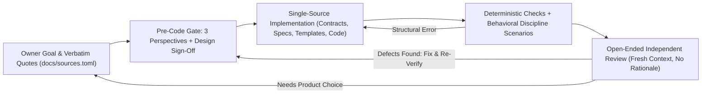
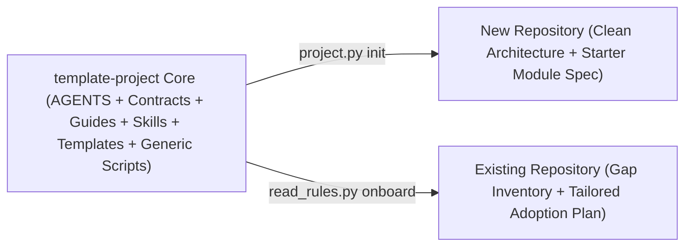

# Architecture Overview

## 1. Purpose, Promises & Non-Goals

`template-project` is an **Engineering Discipline Template** (`discipline_version` in `docs-policy.toml`). Its job is to help human owners and AI coding agents build, evolve, and review software repositories with shared terminology, clear boundaries, plain language, and verifiable accountability.

- **Core Promises**:
  1. **Transferable Engineering Discipline**: Package practical rules (`AGENTS.md`, `docs/contracts/`, `docs/guides/`, `.agents/skills/`) and starter scaffolding (`templates/`) so new (`project.py init`) and existing (`read_rules.py onboard`) repositories adopt the discipline cleanly without carrying `template-project` internal domains.
  2. **Traceable Decisions & Design Gate**: Anchor user quotes in `docs/sources.toml` (`SRC-*`), record design trade-offs in `docs/decisions/ADR-*.md`, and hold major product or UI choices at an explicit owner approval gate before writing implementation code.
  3. **Real Verification & Closed-Loop Review**: Verify both deterministic repository integrity and agent behavioral discipline, using open-ended independent review with the author's explanations withheld that loops back until original findings are verified solved.
- **Explicit Scope Boundary**: This repository delivers reusable engineering discipline, governance workflows, and starter templates; the Python tools in `scripts/` and the optional local web overview serve strictly as bounded helpers for universal structural facts rather than a commercial web application, a dedicated document-extraction framework, or a multi-framework static analyzer.

### Health Constraints

These constraints sit next to the purpose they serve and are reviewed against it (`ADR-008`, `ADR-009`):

1. **Lean, positive-first default context**: Default-loaded rules stay short and follow [docs/README.md](docs/README.md#language-standard); multi-step workflows and habit cleanup stay optional and on-demand.
2. **Lossless, leak-free transfer**: `project.py init` and `read_rules.py onboard` transfer full discipline without leaking `template-project` internal domains, ADRs, or tests.
3. **Facts fail checks; judgments remind**: Build-failing checks remain strictly deterministic facts; numeric thresholds and wording heuristics remind rather than block.
4. **Goal-anchored subtraction**: Holistic reviews check open expectation violations first and consider removing or simplifying rules and side tasks before adding work; subtraction rethinks how to meet the goal cleanly rather than abandoning it.
5. **Bounded complexity by layer**: Core discipline evolves through sharper general abstractions; specialized procedures extend horizontally through on-demand skills; `scripts/` stays capped at universal structural checks rather than framework-specific parsers; the optional web view stays read-only and minimal. Every module's promise implies what it does not promise, keeping most of its work centered on its main role.

## 2. Core Operational Logic & Failure Loop

- **When a check fails**: Automated structure errors return directly to `Build` for cleanup; holistic or consistency defects found during independent review return to `Gate`/`Build` and must be re-verified by the original reviewer before advancing the review baseline.
- **When owner approval is missing**: Product direction or UI architecture drafts stop in `docs/design/` and `docs/work.toml` (`blocked` / `human_check = "pending"`) until the owner explicitly approves an option.

## 3. Hard Constraints, State Ownership & Forbidden Couplings

### Authoritative State Owners

| Fact or State | Single Authoritative Owner | Downstream Derived Consumers |
|---|---|---|
| Verbatim owner requirements & critiques | [docs/sources.toml](docs/sources.toml) (`SRC-*`) | Specs, ADRs, `work.toml` links |
| Non-negotiable engineering rules | [AGENTS.md](AGENTS.md) & [docs/contracts/](docs/contracts/README.md) | `templates/AGENTS*.md`, `scripts/read_rules.py` |
| Approved & pending UI surface designs | [docs/design/perspective-web.md](docs/design/perspective-web.md) & [docs/decisions/ADR-005-calm-platter-frontend-specification-and-perspective-web.md](docs/decisions/ADR-005-calm-platter-frontend-specification-and-perspective-web.md) | `scripts/projectlib/web/`; prior unapproved drafts never unlock code |
| Architectural decisions & rationales | [docs/decisions/](docs/decisions/ADR-004-discipline-first-architecture-and-open-closed-loop-review.md) (`ADR-*`) | Module specs & review baselines |
| Module bounds (`owns`, `promise`, `depends_on`) | [docs/specs/discipline/README.md](docs/specs/discipline/README.md) & sibling domains (`docs/specs/*/`) | Validator, import checks, onboarding |
| Milestones, tasks & review baseline | [docs/work.toml](docs/work.toml) & [docs-policy.toml](docs-policy.toml) (`review_anchor_sha` updated on clean `mark-reviewed`, dirty-worktree state in `tmp/project-state.json`) | `project.py status`, CLI progress summary |

### Hard Constraints & Explicitly Forbidden Couplings

| Constraint or Forbidden Coupling | Rule Summary | Where Enforced |
|---|---|---|
| **No assumed UI approval** | Never treat inherited web code or unapproved sketches in `docs/design/` as owner sign-off (the web overview was rebuilt only after the owner approved its design in `SRC-022` / `ADR-005`). | [frontend-and-visual-discipline.md](docs/contracts/frontend-and-visual-discipline.md), [delivery-and-verification.md](docs/contracts/delivery-and-verification.md) |
| **No template domain leakage** | `scripts/projectlib/doc_inventory.py`, `templates/`, and `project.py init` must never stamp `graph-engine`, `perspective-ui`, or `reference-app` into downstream repos. | [adoption-and-synchronization.md](docs/contracts/adoption-and-synchronization.md), [tests/test_discipline_transfer_and_consistency.py](tests/test_discipline_transfer_and_consistency.py) |
| **Open, closed-loop review with author explanations withheld** | Independent reviewers receive only owner sources and repository files (with author explanations removed), evaluate architecture and consistency openly, and re-verify fixes directly. | [delivery-and-verification.md](docs/contracts/delivery-and-verification.md#independent-review-definition), [grill.md](docs/guides/grill.md) |
| **Architecture beyond static `import` boxes** | Static module import graphs never substitute for runtime control flow, state ownership, forbidden couplings, and failure handling. | [architecture-and-modularity.md](docs/contracts/architecture-and-modularity.md#decomposition-and-ownership) |
| **Role headers, placeholders & non-blocking reminders** | `# Role:` header on every source and style file claimed by a spec's `owns`, zero unresolved placeholders; line budgets (`max_source_lines` / `max_style_lines` in `docs-policy.toml`), catch-all directory names, coined-jargon hints, and hedge phrases remind without failing the build (`ADR-008`, `ADR-009`). | [docs-policy.toml](docs-policy.toml), [docs/README.md](docs/README.md#language-standard) |

## 4. Subsystems Ordered by Product Role

Each domain's stage (`prototype`, `usable`, `stable`) is kept only in its `docs/specs/<domain>/README.md`; `python3 scripts/project.py status` shows the current values.

| Role Priority | Domain ID | Responsibility |
|---|---|---|
| **1. Primary Product** | `discipline` | Owns entry agreements, contracts, `/grill` & independent review protocols, plain-language rules, skills, and starter templates transferred to downstream projects. Spec: [docs/specs/discipline/README.md](docs/specs/discipline/README.md) |
| **2. Live Example** | `reference-app` | Minimal working checkout/CLI exemplar proving how a real product module applies `owns`, single-source state, sequence flows, and plain copy. Spec: [docs/specs/reference-app/README.md](docs/specs/reference-app/README.md) |
| **3. Subordinate Checker** | `graph-engine` | Bounded helper (`check_docs.py`, `read_rules.py`, `project.py` CLI) verifying universal structural facts (links, IDs, single-source version, path ownership, basic imports) without host domain assumptions or framework-specific parsers. Spec & internal layer diagram: [docs/specs/graph-engine/README.md](docs/specs/graph-engine/README.md) |
| **4. Optional Web Overview** | `perspective-ui` | Local HTTP API & 4-view web overview in the default calm-platter style (`project.py serve`). Rebuilt in `scripts/projectlib/web/` under `SRC-022` and `ADR-005` ([perspective-web.md](docs/design/perspective-web.md)). Spec: [docs/specs/perspective-ui/README.md](docs/specs/perspective-ui/README.md) |

## 5. Downstream Transfer Path (`init` & `onboard`)

