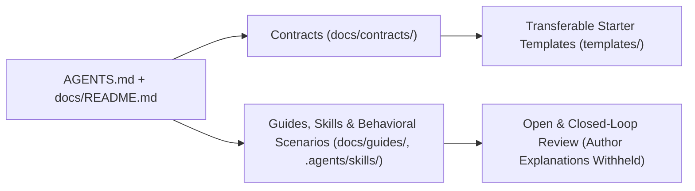

# Engineering Contracts, Guides & Starter Templates

## Positioning & Non-Goals

`discipline` is the primary product of `template-project`: it defines how human owners and AI coding agents keep a repository clear, single-source, and verified from `0->0.1` through `1->N`. It owns normative contracts, guides, skills, and transferable starter templates, and leaves repository-specific Python/JS tooling implementation to sibling domains.

## Boundaries & Key Invariants

- **Authoritative home**: `AGENTS.md` and `docs/contracts/` own normative rules; `templates/` preserves those core rules in starter form for downstream `init` and `onboard` repositories.
- **Forbidden coupling**: Unapproved drafts in `docs/design/` or older UI code never qualify as owner approval; downstream starter files must never leak `template-project` internal domain IDs.
- **Governing decision**: [ADR-004](../../decisions/ADR-004-discipline-first-architecture-and-open-closed-loop-review.md).

## Entrypoints & Fitness Checks

- **Entrypoints**: [AGENTS.md](../../../AGENTS.md) and [docs/README.md](../../README.md).
- **Fitness checks**: Run `python3 scripts/check_docs.py --strict`, `python3 scripts/read_rules.py`, and `tests/test_discipline_transfer_and_consistency.py` to verify plain prose, transfer completeness, and zero leaked template domains.
- **Behavioral evaluation log**: [behavioral-scenarios-2026-11.md](../../evaluations/behavioral-scenarios-2026-11.md).
