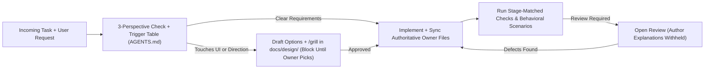

# Entry Rules & Engineering Contracts

## 1. Purpose, Narrow Interface & Non-Goals

- **Public interface**: Human/AI reading entry (`AGENTS.md`, `docs/README.md`) and topical contracts under `docs/contracts/` fetched selectively via `read_rules.py prepare --concern <slug>` or trigger table in `AGENTS.md`.
- **Out of scope**: Runtime Python execution (owned by `graph-engine`) and starter file copies transferred verbatim without adaptation (owned by `discipline.templates`).

## 2. Runtime Governance Loop & Failure Paths

## 3. State Ownership, Hard Invariants & Forbidden Couplings

- **Single authoritative owners**: Normative rules live only in `AGENTS.md` and `docs/contracts/*.md`; language rules live only in `docs/README.md#language-standard`.
- **Forbidden couplings**: Unapproved drafts in `docs/design/` or older UI code MUST NOT count as approval to implement a design; reviewers MUST NOT receive author justifications or narrow code-only checklists before holistic inspection.
- **Verification**: Enforced mechanically by `read_rules.py` span integrity checks, `check_docs.py --strict`, and downstream sync checks in `tests/test_discipline_transfer_and_consistency.py`.
