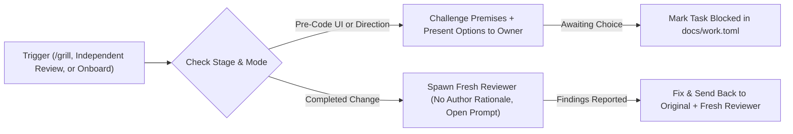

# Operational Guides & Agent Skills

## 1. Purpose, Narrow Interface & Non-Goals

- **Public interface**: Procedural playbooks (`docs/guides/{onboarding,grill,research-and-access}.md`), core portable skills (`.agents/skills/{grill,onboard-discipline}/SKILL.md`) transferred on `init` / `onboard`, and optional standalone self-contained add-on skills (`.agents/skills/clean-chatgpt-flavor/SKILL.md`, `.agents/skills/deep-research/SKILL.md`, `.agents/skills/plain-chinese-writing/SKILL.md`) invoked on demand or copied independently without expanding default context.
- **Out of scope**: Setting standalone policy rules outside `AGENTS.md` / `docs/contracts/` or modifying product code without target-repo confirmation during external onboarding.

## 2. Operational Procedure & Escalation Flow

## 3. Constraints, State Ownership & Forbidden Couplings

- **Single authoritative owners**: Review protocol steps live in `docs/guides/grill.md`; onboarding inventory protocol lives in `docs/guides/onboarding.md`.
- **Forbidden couplings**: Skills MUST NOT hardcode `template-project` internal domain assumptions or skip `read_rules.py onboard` when assessing an external codebase; pre-fix rationales MUST NOT leak into independent reviewer prompts.
- **Verification**: Anchor resolution (`#behavioral-discipline-evaluation-scenarios`), `test_read_rules_and_onboard.py`, and `test_discipline_transfer_and_consistency.py`.
