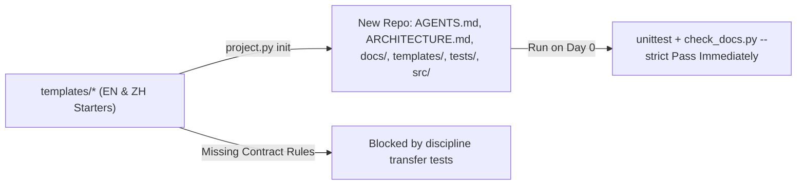

# Starter Templates for Adopting Projects

## 1. Purpose, Entrypoints & Non-Goals

- **Public interface**: Bilingual starter skeletons under `templates/` consumed exclusively by `project.py init` (`perspective.server`) or manual repository onboarding (`docs/guides/onboarding.md`).
- **Out of scope**: Replacing host project business requirements or leaking `template-project` internal domain names (`graph-engine`, `perspective-ui`, `reference-app`) into product repositories.

## 2. Downstream Transfer & Validation Flow

## 3. State Ownership, Hard Invariants & Forbidden Couplings

- **Core rule parity**: `templates/AGENTS*.md`, `templates/docs-readme*.md`, and `templates/ARCHITECTURE*.md` MUST retain Priority Order, UI approval gate, five-part architecture requirements, open closed-loop review, and 5-step pre-edit context lookup from root agreements.
- **Chinese downstream language boundary (`SRC-021`)**: When initialized with `--lang zh`, entry agreements, architecture/spec/decision/review templates, `work.toml`, directory labels, and CLI outputs are generated and validated in plain Chinese, while `docs/contracts/` and `docs/guides/` remain canonical English originals unless explicitly localized later.
- **Forbidden couplings**: Starter templates outside `templates/` MUST NOT contain unresolved `{{...}}` placeholders; copied downstream files MUST keep `[project].identity = "product"` and clean `tests/` / `src/` directories so default commands work on Day 0.
- **Verification**: Validated by `test_discipline_transfer_and_consistency.py` across both `--lang en` and `--lang zh`.
