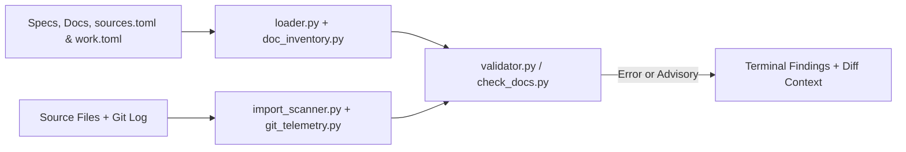
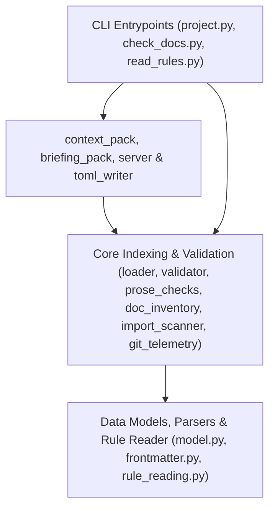

# Document & Code Graph Checker

> [!NOTE]
> `graph-engine` is a **subordinate verification helper**, not the core product of `template-project`. Its job is mechanical validation and rule loading; qualitative design and architecture review stay with human owners and independent reviewers.

## 1. Execution Pipeline (Files & Code -> Graph -> Checks)

## 2. Actual Module Layering & Explicit Boundaries

Modules under `scripts/` obey strict one-way dependencies (`Base` owns pure data types; `Core` indexes and validates; `Pack` serializes and writes back; `CLI` exposes user commands):

## 3. State Ownership & Forbidden Couplings

| Constraint or Forbidden Coupling | Rule Summary | Enforced By |
|---|---|---|
| Hardcoded `template-project` domains inside `doc_inventory.py` | Infer directory domain dynamically from target repo specs; keep shared multi-domain directories neutral | `tests/test_discipline_transfer_and_consistency.py` |
| Static AST `import` graphs presented as system architecture | Show module dependencies as structural coupling only; document runtime logic and state separately | `docs/contracts/architecture-and-modularity.md` |
| `validator.py` or `loader.py` mutating tracked project docs | Read-only checks report errors and exit status without altering `sources.toml` or specs | `validator.py` read-only check path |
| `Core` importing `briefing_pack` or `server` | Headless `check_docs.py` runs with zero HTTP server or UI dependencies | Module `depends_on` graph |

## 4. Entrypoints & Fitness Checks

- **CLI entrypoints**: `python3 scripts/check_docs.py [--strict]`, `python3 scripts/read_rules.py {list,prepare,read,overview,onboard}`, and `python3 scripts/project.py {status,context,trace,check}`.
- **Fitness checks**: `tests/test_ssot_and_check_docs.py`, `tests/test_read_rules_and_onboard.py`, and `tests/test_discipline_transfer_and_consistency.py`.
