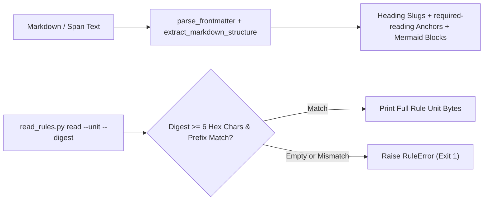

# Graph Model, Frontmatter Parser & Rule Reader

## 1. Purpose, Public Interface & Non-Goals

- **Public interface**: Dataclasses (`ProjectGraph`, `DomainSpec`, `ModuleSpec`, `DecisionRecord`, `SourceAnchor`, `Milestone`, `WorkTask`, `ValidationFinding`), `module_source_refs`, `match_path_pattern`, `matches_any_pattern`, `normalize_doc_roots`, `parse_frontmatter`, `extract_markdown_structure`, `has_inline_role_header`, and `RuleRepository`.
- **Out of scope**: Disk filesystem walks, Git subprocess calls, HTTP handling, or TOML writes.

## 2. Parsing & Digest-Verified Rule Flow

## 3. State Ownership, Hard Invariants & Forbidden Couplings

- **Pure Base Invariant**: `model.py` and `frontmatter.py` accept text/values only and never import sibling `projectlib` modules or execute shell commands (`depends_on: []`).
- **Digest Integrity Guard**: `RuleRepository.read` rejects empty or short `< 6`-character digests so callers cannot bypass SHA-256 verification.
- **Verification**: Covered by `tests/test_ssot_and_check_docs.py` and `tests/test_read_rules_and_onboard.py`.
