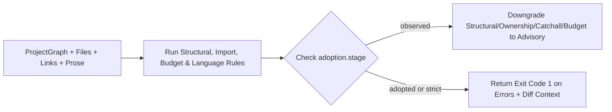

# Graph Validator, `check_docs.py` & `read_rules.py`

## 1. Purpose, Public Interface & Non-Goals

- **Public interface**: `validate_project_graph(graph, strict, diff_base)`, CLI `python3 scripts/check_docs.py [--strict]`, and `python3 scripts/read_rules.py {list,overview,prepare,read,onboard}`.
- **Out of scope**: Substituting automated link/budget checks for holistic architectural or behavioral review (`delivery-and-verification.md`).

## 2. Validation & Stage Severity Flow

## 3. State Ownership, Hard Constraints & Forbidden Couplings

- **Full Markdown & Budget Scanning**: `collect_live_markdown_files` scans root entry files, `docs/`, `templates/`, and `.agents/` (excluding nested `archive/` directories), plus active `README.md` files under `tests/`, `src/`, `examples/*/`, and root `archive/README.md`. `read_rules.py onboard` reads `[budgets]` from target `docs-policy.toml` when present and flags catch-all `utils/`/`helpers/`/`common/`/`misc/` folders alongside `.mjs`/`.cjs` files.
- **Forbidden couplings**: `validator.py` and CLI checkers stay read-only against project files (`never auto-edit specs`); `observed` onboarding mode must not break existing CI on legacy debt before explicit adoption.
- **Verification**: Tested by `test_ssot_and_check_docs.py` and `test_read_rules_and_onboard.py`.
