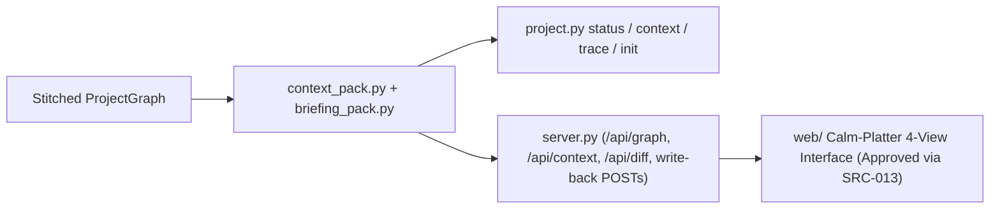

# Project Overview CLI & Local Website

## 1. Domain Role, Flow & Non-Goals

- **Positioning**: `perspective-ui` is a supporting reader interface over `ProjectGraph`. It explains repository status (`project.py status`, `context`, `trace`) and hosts the calm-platter local JSON/HTML web UI (`project.py serve`, `export-html`).
- **Out of scope**: Authoring discipline rules or modifying code without owner confirmation on unapproved future redesigns.

## 2. Boundaries, State Ownership & Forbidden Couplings

| Constraint or Forbidden Coupling | Rule Summary | Enforced By |
|---|---|---|
| **Frontend specification compliance** | `ui.perspective-web` implements the owner-approved `SRC-013` specification; any future major layout change requires an explicit option comparison and owner approval before editing. | `docs/design/perspective-web.md`, `docs/contracts/frontend-and-visual-discipline.md` |
| **Pure context/trace lineage** | `context_pack` traces sources and ADRs strictly via explicit task `decisions`/`sources` links; never invent cross-task matches through superseded ADRs. | `tests/test_discipline_transfer_and_consistency.py` |
| **No TOML data corruption** | Write-back mutations validate CSRF Origin/Token, validate JSON before touching `sources.toml` or `work.toml`, preserve custom keys, and block silent archive overwrites. | `test_project_cli_and_server.py` |

## 3. Single-Source State & Hard Invariants

- **Repository facts** live exclusively in `docs/sources.toml`, `docs/work.toml`, `docs/specs/**/*.md`, `docs/decisions/ADR-*.md`, `docs/design/*.md`, and `docs-policy.toml`; `perspective-ui` computes CLI output and HTTP JSON strictly on demand from `ProjectGraph` (`briefing_pack.py`) without duplicating or caching authoritative files.
- **Transient review and UI state** keeps test/dirty-worktree digests in `tmp/project-state.json` and transient view selection in browser memory (`uiState`) only; any durable owner resolution or sign-off writes back to `docs/sources.toml` or `docs/work.toml`.

## 4. Entrypoints & Fitness Checks

- **CLI & HTTP entrypoints**: `python3 scripts/project.py {status,context,trace,init,serve,export-html,archive-milestone,mark-reviewed}`.
- **Fitness checks**: `tests/test_project_cli_and_server.py`, `tests/test_web_workbench.py`, and `tests/test_chrome_geometry.py`.
