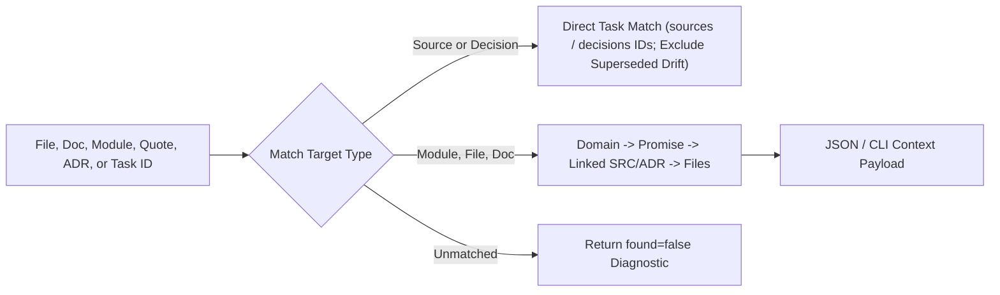

# Context Pack & Web Payload Builder

## 1. Purpose, Public Interface & Non-Goals

- **Public interface**: `build_context_pack(graph, target)`, `build_lineage_trace(graph, node_id)`, and `serialize_perspective_payload(graph, csrf_token)`.
- **Out of scope**: Mutating files on disk, spawning subprocesses, or making web UI layout decisions.

## 2. Lookup & Traceability Assembly Flow

## 3. State Ownership, Hard Invariants & Forbidden Couplings

- **Direct Lineage Precision**: `build_lineage_trace` attributes tasks to a source directly when `src_id in t.sources`, and attributes tasks to a decision ONLY when `dec.id in t.decisions` (for active decisions matching `affects` when no explicit task override conflicts, and NEVER sweeping current tasks onto `superseded` ADRs).
- **Complete Inbox Links**: Blocked and ready tasks retain full `specs`, `sources`, and `design_docs` arrays in addition to primary display metadata.
- **Forbidden couplings**: Imports `graph.*` read-only; never runs `git`, edits TOML, or imports `server.py`.
