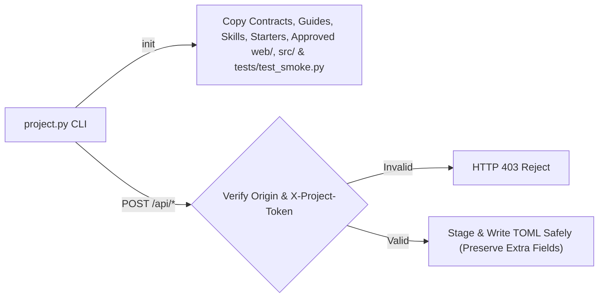

# Local Perspective HTTP Server & `project.py` CLI

## 1. Purpose, Public Interface & Non-Goals

- **Public interface**: CLI `python3 scripts/project.py {init,status,context,trace,check,serve,export-html,archive-milestone,mark-reviewed}`, plus local HTTP routes (`/api/graph`, `/api/overview`, `/api/context`, `/api/diff`, `/api/tasks/*`, `/api/review/mark`, `/api/tests/run`).
- **Out of scope**: Authoring unapproved layout changes outside `docs/design/` or auto-committing changes to Git.

## 2. Initialization, Serving & Write-Back Flow

## 3. State Ownership, Hard Invariants & Forbidden Couplings

- **Complete `init` Guarantee**: On clean/empty targets `project.py init` creates `README.md`, `docs/specs/example/module.md`, `src/example/`, and `tests/test_smoke.py`; on existing codebases (where any non-tooling directory or root source file already contains code, excluding copied `scripts/` governance tools) it omits `example` starter stubs, auto-sets `[adoption] stage = "observed"` and detected `source_roots`, and leaves Day-0 `work.toml` `specs = []`. When run against a cloned or copied template checkout whose remote is not `template-project`, it removes internal template domains, ADRs, designs, archives, and example code while writing clean target-language starters. `init --sync` implements the upgrade path whose exact scope (what is refreshed, what is preserved, what is printed) is defined once in [adoption-and-synchronization.md](../../contracts/adoption-and-synchronization.md#3-incremental-discipline_version-upgrades). It copies `scripts/projectlib/` including the approved `web/` UI assets (with `server.py` keeping a safe fallback HTML view if `web/` is omitted).
- **Safe TOML & Review State**: `toml_writer.py` preserves unknown keys and leading comments, refuses silent archive overwrite collisions without explicit merge/guard, validates task existence before mutating `sources.toml`, and records preset `blocker_options` picked in the web overview on the task (`selected_option`) rather than copying that option text into `docs/sources.toml`; text the owner selects or pastes as an answer in conversation may be recorded as a quote under the rule in `collaboration-and-governance.md`. `mark_review_anchor` updates `docs-policy.toml` (`review_anchor_sha`) when the Git working tree is clean and records uncommitted working-tree digests in `tmp/project-state.json`.
- **Forbidden couplings**: `shell=True` subprocess execution is banned; foreign `Origin` or missing `X-Project-Token` POST calls always return HTTP 403.

## 4. Entrypoints & Fitness Checks

- **CLI entrypoints**: `python3 scripts/project.py {init,status,context,trace,check,serve,export-html,archive-milestone,mark-reviewed}`.
- **Fitness checks**: `tests/test_project_cli_and_server.py`, `tests/test_read_rules_and_onboard.py`, `tests/test_discipline_transfer_and_consistency.py`, and `python3 scripts/check_docs.py --strict`.
