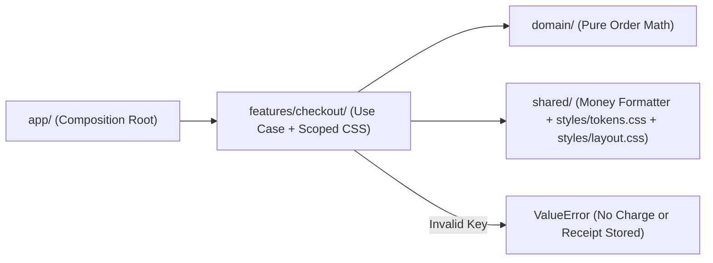

# Reference Modular App Example (`examples/reference-app/`)

## 1. Positioning & Non-Goals

This domain is a **live teaching example** verified by automated tests (`tests/test_reference_exemplar.py`)—distinct from `template-project`'s governance rules (`discipline`) and helper validator scripts (`graph-engine`).

## 2. Layer Flow & Failure Boundaries

## 3. Bounded Coupling & Single-Source Rules

| Constraint or Forbidden Coupling | Rule Summary | Enforced By |
|---|---|---|
| Upward imports from `domain/` or `shared/` into `features/` or `app/` | Inner layers stay reusable and side-effect free | `depends_on: []`, `check_docs.py` |
| Catch-all `utils/` or `helpers/` buckets | Shared formatting lives in named value modules (`shared/money.py`) | `validator.py` catch-all ban |
| Duplicate fee calculation or hardcoded CSS hex colors | Order math lives once in `domain/`; colors live in `shared/styles/tokens.css` | `exemplar.domain`, `exemplar.shared` |

## 4. Entrypoints & Fitness Checks

- **Entrypoint**: [main.py](../../../examples/reference-app/app/main.py) (`render_checkout_preview`).
- **Fitness checks**: Run `python3 -m unittest tests/test_reference_exemplar.py` for end-to-end checkout, math, and CSS layer ownership checks, plus `python3 scripts/check_docs.py --strict` for boundary verification.
