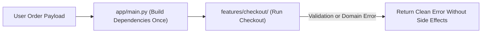

# Reference App — Application Entrypoint

## 1. Purpose, Public Interface & Non-Goals

- **Public interface**: `examples/reference-app/app/main.py` composition entrypoint (`run_demo_checkout()`).
- **Out of scope**: Order pricing math, idempotency storage, or direct DOM/CSS styling definitions.

## 2. Wiring Flow & Boundaries

## 3. State Ownership & Forbidden Couplings

- **State**: Holds composition wiring references only; delegates transactional order state to `exemplar.checkout`.
- **Forbidden couplings**: Lower layers (`features/`, `domain/`, `shared/`) MUST NOT import `app/`; business rules belong in `domain/`, never in `main.py`.
- **Verification**: Exercised end-to-end by `tests/test_reference_exemplar.py` and `check_docs.py`.
