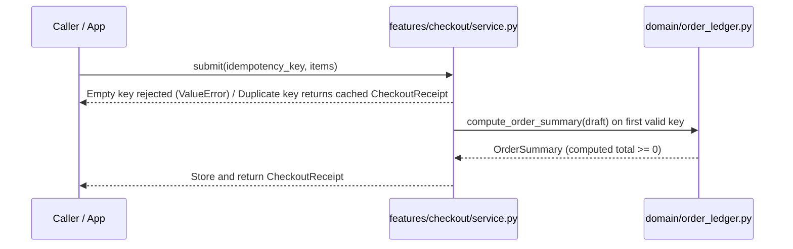

# Reference App — Checkout Feature Slice

## 1. Purpose, Public Interface & Non-Goals

- **Public interface**: Checkout submission handler (`examples/reference-app/features/checkout/service.py`) and component-local stylesheet (`examples/reference-app/features/checkout/CheckoutCard.module.css`).
- **Out of scope**: Top-level application startup (`app/`) or redefining currency tokens (`shared/styles/tokens.css`).

## 2. Runtime Checkout Flow, Retry Cache & Rejection Paths

## 3. State Ownership, Hard Invariants & Forbidden Couplings

- **Idempotency & Rejection Invariant**: Blank `idempotency_key` raises an explicit error before any calculation or write; a previously completed key returns its exact stored receipt without calling `Ledger` or charging again.
- **Forbidden couplings**: May depend on `exemplar.domain` and `exemplar.shared`, and must never import upward into `exemplar.app`.
- **Verification**: Tested for empty keys, first-submit receipts, and duplicate-key retry idempotency in `tests/test_reference_exemplar.py`.
