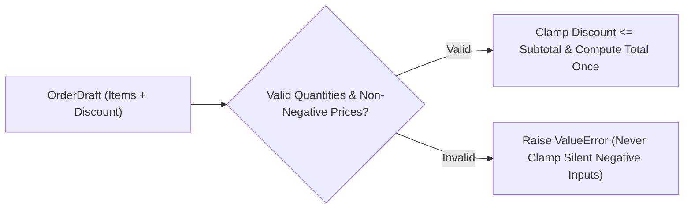

# Reference App — Pure Domain Layer

## 1. Purpose, Public Interface & Non-Goals

- **Public interface**: `compute_order_summary(draft)` and domain dataclasses inside `examples/reference-app/domain/order_ledger.py`.
- **Out of scope**: Persistence, HTTP requests, idempotency caching, or string formatting/CSS.

## 2. Pure Calculation & Validation Flow

## 3. State Ownership, Hard Invariants & Forbidden Couplings

- **Single calculation invariant**: Total order value is never recomputed downstream; discounts clamp at subtotal (`total >= 0`).
- **Forbidden couplings**: `depends_on: []` — never imports `shared/`, `features/`, or `app/`.
- **Verification**: Tested by `tests/test_reference_exemplar.py` and import checks in `check_docs.py`.
