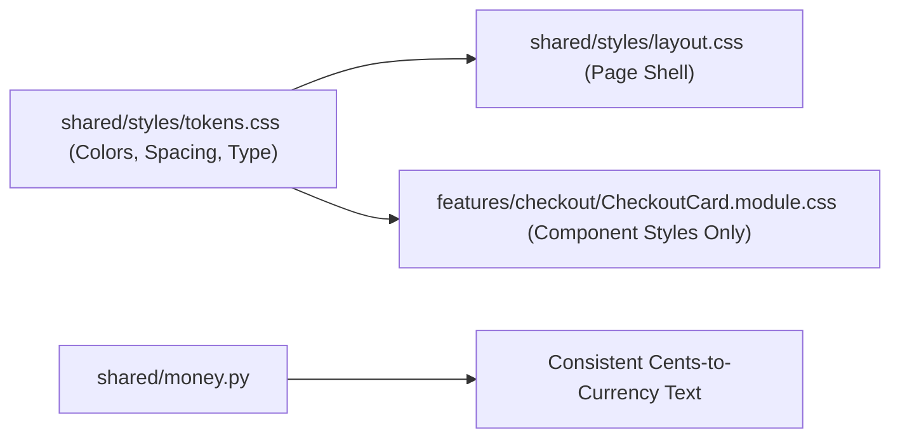

# Reference App — Shared Formatters & Design Tokens

## 1. Purpose, Public Interface & Non-Goals

- **Public interface**: `shared/money.py` formatting helpers plus base CSS sheets `shared/styles/tokens.css` and `shared/styles/layout.css`.
- **Out of scope**: Order math (`exemplar.domain`), feature-specific DOM selectors, or generic `utils/` catch-all files.

## 2. Asset & Formatting Flow

## 3. State Ownership, Constraints & Forbidden Couplings

- **Layered CSS Invariant**: Color hex values live only in `shared/styles/tokens.css`; component styles under `features/` reference CSS custom properties (`var(--...)`) rather than duplicating palette literals.
- **Forbidden couplings**: `depends_on: []` — never imports `domain/`, `features/`, or `app/`, and never uses `utils/`/`helpers/` directory names.
- **Verification**: Checked by `tests/test_reference_exemplar.py` and CSS size/ownership checks in `check_docs.py`.
