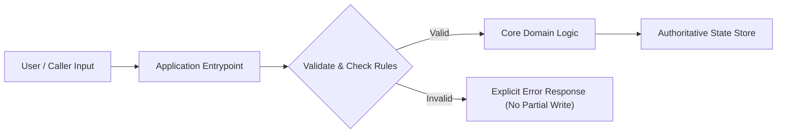

# Architecture Overview

## 1. Purpose, Core Promises & Out-of-Scope Boundaries

State directly who uses this system, what measurable outcome it delivers, and
which responsibilities stay outside its boundary.

### Health Constraints

List a small set of project-chosen health constraints next to the goal they
serve, and adjust them sparingly against that goal:

1. Keep every shared fact or state value owned by one authoritative file rather than duplicated across modules.
2. Keep module boundaries explicit so changes stay local and verifiable.

## 2. End-to-End Runtime Flow & Failure Handling

Describe how requests run end-to-end, where decisions branch, and how errors or
retries recover without corrupting state.

## 3. Bounded Subsystems, Interfaces & Forbidden Couplings

- **Subsystems & Public Interfaces**: List each bounded domain (`docs/specs/<domain>/README.md`) and the narrow interface callers may invoke.

| Forbidden Coupling | Why Banned | Enforced By |
|---|---|---|
| Core domain importing UI or CLI formatting code | Keeps domain logic testable and independent of presentation | `docs/specs/` & `check_docs.py` |
| UI or helper scripts mutating state while bypassing domain checks | Prevents inconsistent state across views | Single entrypoint API |

## 4. Authoritative State Owners & Hard Invariants

| State or Constraint | Single Authoritative Owner | Hard Invariant / Enforced Guard |
|---|---|---|
| Owner requirements | `docs/sources.toml` (`SRC-*`) | Verbatim quotes only; linked via `work.toml` |
| Module bounds & promises | `docs/specs/<domain>/` | Exclusive `owns`; declared `depends_on` only |
| Domain runtime state | Primary store / service defined by module specs | Validate constraints before any state write |

## 5. Verification & Next Entrypoints

- Requirements & tasks: `docs/sources.toml` and `docs/work.toml`
- Module contracts: `docs/specs/`
- Checks: `python3 -m unittest discover -s tests -p 'test_*.py'` and `python3 scripts/check_docs.py`
