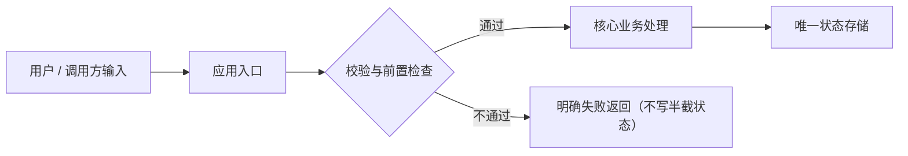

# 系统架构总览

## 1. 定位、核心承诺与外部边界

直接写明这套系统服务哪类使用者、解决什么具体问题、对外保证什么结果，以及哪些职责明确归属外部，避免后续越界堆叠功能。

### 健康约束

紧挨系统目标写下少量自选健康约束，后续对照目标审慎微调：

1. 每项跨模块共享的事实或状态只保留一个权威来源，不手工复制多份。
2. 保持模块职责边界清晰，确保改动局部可验证、不静默漂移。

## 2. 端到端运行逻辑与失败处理

说明主流程如何从触发走向完成、关键状态如何切换，以及校验失败或依赖异常时如何安全退出或回退。

## 3. 子系统接口与禁止耦合清单

- **子系统与公开接口**：列出各业务域（`docs/specs/<域目录>/README.md`）及其允许被外部调用的窄接口。

| 禁止的耦合关系 | 原因 | 守门方式 |
|---|---|---|
| 核心域直接依赖界面层或终端输出 | 避免业务规则与展示逻辑混在一起 | 模块规格 `depends_on` 与 `check_docs.py` |
| 前端或辅助脚本绕过核心校验直接改状态 | 防止多个界面或入口出现状态分叉 | 统一通过单一写入入口 |

## 4. 唯一状态真源与硬约束

| 核心事实或约束 | 唯一权威真源 | 硬约束 / 守门方式 |
|---|---|---|
| 负责人需求原话 | `docs/sources.toml`（`SRC-*`） | 只保留一字不改原话，并在任务单关联 |
| 模块职责边界与接口 | `docs/specs/<域目录>/` | 代码路径归属不重叠，禁止未声明跨模块依赖 |
| 核心业务数据状态 | 核心存储 / 唯一管理模块 | 任何写入前必须校验前置条件，失败不写半截状态 |

## 5. 常用入口与核验

- 需求与待办账本：`docs/sources.toml`、`docs/work.toml`
- 模块规格目录：`docs/specs/`
- 测试与结构检查：`python3 -m unittest discover -s tests -p 'test_*.py'` 与 `python3 scripts/check_docs.py`
