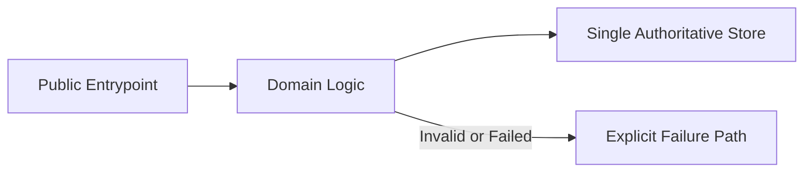

# {{Domain Name}}

## Domain Role & Runtime Flow

State what enters this subsystem, what stays outside it, and how work runs
from entry to output (including failure paths):

## Narrow Interfaces & Forbidden Couplings

- **Public Interface**: {{Functions, routes, or CLI entrypoints exposed to sibling domains}}
- **Forbidden Couplings**: {{Cross-domain imports or direct state mutations banned here}}
- **Hard Invariants & Constraints**: {{Data limits, idempotency, authorization, or compatibility guards}}
