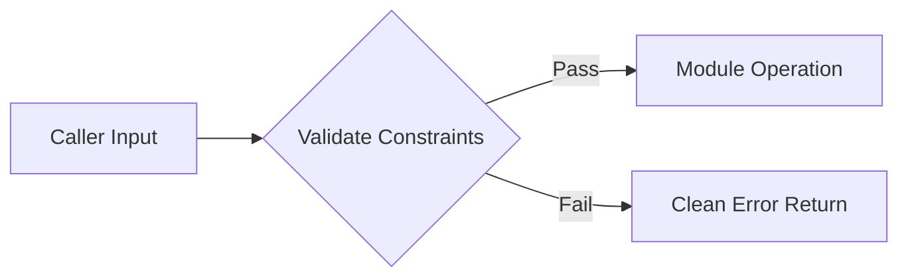

# {{Module Title}}

## Public Entrypoint & Owned Scope

State what functions or classes external callers may invoke and what stays internal.

## State Ownership, Invariants & Failure Handling

State which state this module owns exclusively, what hard limits hold before any write or side effect, and how invalid input or external failures behave.

## Runtime / State Flow (`mermaid` when non-trivial)

